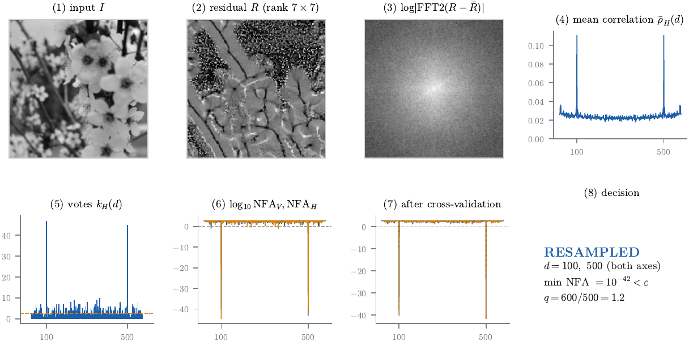

# IMA01 - Detection de reechantillonnage par correlation spectrale

Re-implementation de Li, Bammey et al., *Image Resampling Detection via Spectral Correlation
with False Alarm Control*. Aymen Ouerghi, Mohamed Missaoui (Telecom Paris), encadrant Quentin Bammey.

    pip install -r requirements.txt
    python -m pytest -q                       # 5 tests (tests/test_detecteur.py)
    python experiences/exp_exemple_1D.py      # exemple 1D du rapport (Section 3)

## Le detecteur en une image

Une photographie RAISE agrandie par q = 1.2 (cubique), passee dans `detect()` (`src/detector.py`) :

| Etape | Ce qu'on voit | Fonction |
|---|---|---|
| (1) | image d'entree, niveaux de gris | `image_io.load_gray` |
| (2) | residu : rang de chaque pixel dans sa fenetre 7x7 (le contenu disparait) | `residual.rank_transform_2d` |
| (3) | spectre `FFT2(R - moyenne)` | `numpy.fft.fft2` dans `detector.detect` |
| (4) | correlation moyenne des 100 patches selon le decalage d : pics a d = 100 et 500 = +-600/1.2 mod 600 | `spectral.patch_correlations_2d` |
| (5) | votes k(d) : nombre de patches dont la correlation est maximale a d dans [d-20, d+20] | `acontrario.count_votes` |
| (6) | log10 NFA sur l'axe vertical (bleu) et horizontal (orange) | `acontrario.compute_nfa` |
| (7) | apres validation croisee des deux axes | `acontrario.cross_validate` |
| (8) | decision : NFA = 10^-42 < 1, detectee aux distances attendues, d'ou le facteur q = 600/500 = 1.2 | `acontrario.detect_2d` |

## Organisation

| Dossier / fichier | Contenu | Rapport |
|---|---|---|
| `src/dft.py` | `dft`, `idft` (convention 1/N du papier) | 3.1 |
| `src/resampling.py` | 4 noyaux, `wrap`, `resample_1d`, `resampling_matrix`, `resample_2d_fast` | 2.1, 3.1, 4.1 |
| `src/spectral.py` | `pcc_complex`, `patch_correlations_1d`, `patch_correlations_naive` (reference 2D), `_cyclic_window_sum` + `_correlation_axis` (version FFT), `patch_correlations_2d`, `hermitian_half` (limites) | 2.2, 3.2, 4.2, 7 |
| `src/acontrario.py` | `tested_distances`, `count_votes`, `binomial_tail`, `compute_nfa`, `decide`, `cross_validate`, `jpeg_distances`, `jpeg_valid_mask`, `detect_2d` | 2.3-2.5, 3.3-3.4, 4.3, 5.3 |
| `src/residual.py` | `rank_transform_2d`, `forward_gradient`, `divergence`, `tv_denoise_chambolle`, `tv_residual`, `extract_residual` | 5.2 |
| `src/detector.py` | `detect` : la chaine complete sur une image | 4, Fig. 1 |
| `src/image_io.py` | lecture PNG/JPEG/TIFF, luminance BT.601, ecriture PNG/JPEG | 6.3 |
| `src/dataset.py` | `downsample2`, `crop_size_for`, `resample_and_crop`, `expected_distances` | 5.1, 6.3 |
| `experiences/` | une experience = un script qui affiche les chiffres du rapport | 3, 6.1, 6.2, 7 |
| `scripts/` | jeu RAISE : telechargement, preparation, detection, tableaux | 6.3 |
| `test_contribution/` | benchmark du moteur de correlation (naive / nous / auteurs) | 4.2 |
| `tests/test_detecteur.py` | 5 verifications : 2D = 1D, copie du spectre, FFT = naive, NFA, detecteur complet | - |
| `results/final/` | resultats RAISE du rapport (CSV, une ligne par image) + `table4.txt`, `ablation.txt`, `fp_calibration.txt` | 6.3 |
| `results/h0_bruit.txt` | fausses alarmes sur bruit blanc (limites) | 7 |

## Experiences (chaque script affiche les valeurs donnees dans le rapport)

| Script | Rapport |
|---|---|
| `exp_exemple_1D.py` | exemple fil rouge 1D, Fig. 4-5 |
| `exp_L_1D.py`, `exp_r_1D.py` | E1, E2 : taille de patch L et rayon r, 30 signaux |
| `exp_kernel_1D.py`, `exp_fact_1D.py`, `exp_r_vs_d_1D.py` | E3, E4, E5 |
| `exp_detection_bruit_2d.py` | EXP 1 : bruit blanc 2D |
| `exp_pic_2d.py` | EXP 2 : bruit colore |
| `exp_formes_geometriques.py` | EXP 3 : formes geometriques, ablation none / rt / tv |
| `exp_baboon.py` | EXP 4 : images des auteurs (baboon, pashmina) |
| `exp_h0_bruit.py` | limite : fausses alarmes sur bruit blanc, symetrie hermitienne |

## Jeu RAISE (Section 6.3)

    python scripts/download_raise.py --csv data/RAISE_1k.csv --n 200
    python scripts/prepare_raise.py --workers 4                        # PNG, JPEG 95, JPEG 90
    python scripts/run_detection.py --format png    --workers 4        # -> results/final/
    python scripts/run_detection.py --format jpeg95 --workers 4
    python scripts/run_detection.py --format jpeg90 --workers 4
    python scripts/run_detection.py --format png --kernel cubic --residual none --workers 4   # ablation
    python scripts/run_detection.py --format png --kernel cubic --residual tv   --workers 4
    python scripts/prepare_resizers.py --n 200 --kernels cubic --workers 4                    # Pillow
    python scripts/run_detection.py --data data/resizers --format png --workers 4 --out results/final/detection_png_rt_pil.csv
    python scripts/table4.py          # Tables 3-4 du rapport
    python scripts/ablation.py        # Table 5
    python scripts/fp_calibration.py  # faux positifs des originales selon eps

Par defaut tous les patches votent, comme dans le papier (c'est la version de nos resultats).
`--hermitien` (un patch par paire miroir) est l'option discutee dans les limites.
